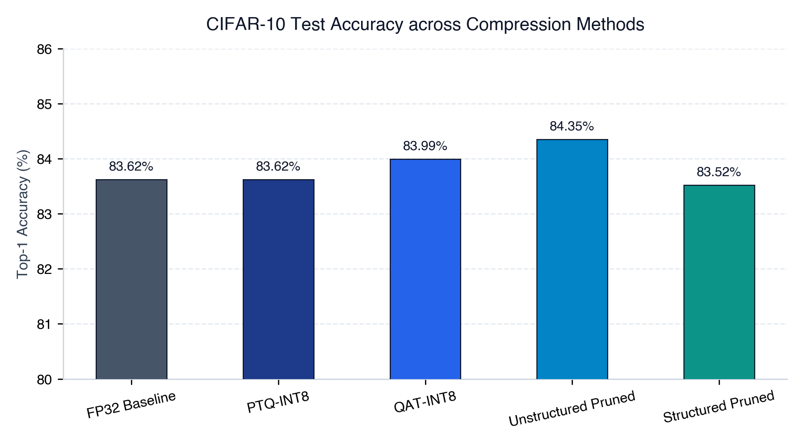
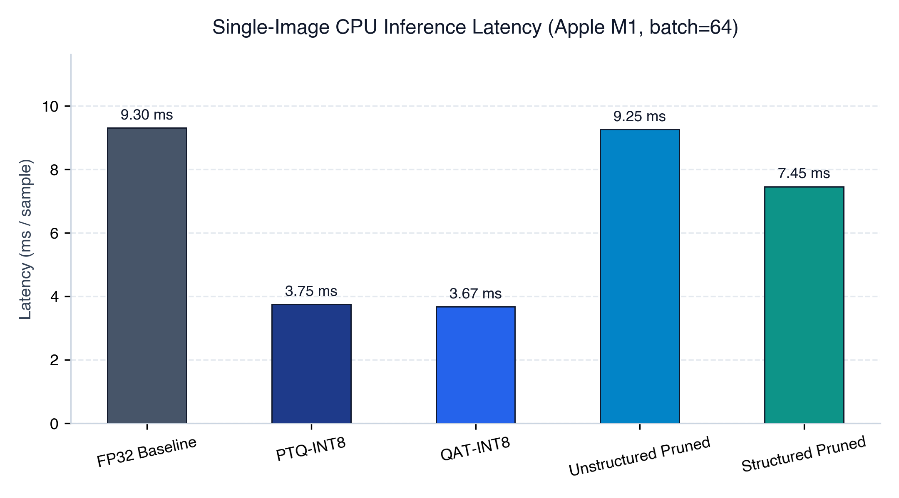
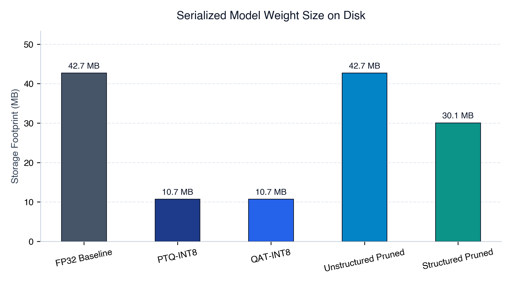
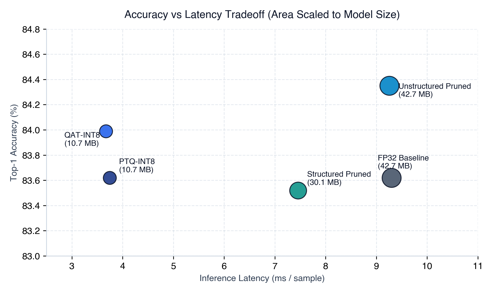

# Edge-Optimized Neural Compression: Quantization, Pruning, and Low-Latency Embedded Inference

**Institution**: FAST NUCES  
**Course**: Edge Computing & Intelligent Systems  
**Author**: Aimal Khan (`i211701`, Section `A`)  
**Evaluation Platform**: Apple M1 (8-core ARM64 CPU, 16 GB Unified Memory)  
**GitHub Repository**: [aimal-khan/Edge-Computing-Assignment-03](https://github.com/aimal-khan/Edge-Computing-Assignment-03)  
**Deliverable Archive**: `i211701_A.zip`  

---

## 1. Problem Formulation & Hardware Context

Deep convolutional networks designed for server-class GPUs routinely fail when deployed to battery-powered or embedded microprocessors. On an edge device like an ARM Cortex-A or an Apple Silicon core, the primary performance bottleneck is rarely raw floating-point computation; it is memory bandwidth. Under the Roofline model, deep neural network inference operates in the memory-bound regime. Every floating-point parameter fetched from off-chip DRAM consumes an order of magnitude more energy than the arithmetic operation that processes it.

Standard ResNet-18 contains over 11.17 million parameters. Stored in IEEE 754 single-precision floating point (FP32), these weights occupy 42.7 MB of memory. Passing a batch of activations through this topology causes substantial cache thrashing, evicting working sets from L1 and L2 caches and incurring latency penalties.

To make this architecture viable for low-power edge deployment, we explored two distinct compression techniques on CIFAR-10:
1. **Integer Quantization**: Lowering numerical precision from 32-bit floats to 8-bit integers via Post-Training Static Quantization (PTQ) and Quantization-Aware Training (QAT).
2. **Neural Network Pruning**: Eliminating superfluous parameters through iterative unstructured magnitude pruning and structured channel pruning with physical architectural reconstruction.

All models were evaluated under uniform test conditions on the full 10,000-image CIFAR-10 test partition, compiled to Open Neural Network Exchange (ONNX) graphs, and profiled on CPU runtimes.

```
       +-----------------------------------------------------------+
       |           Baseline FP32 ResNet-18 (11.17M Params)         |
       |                   Accuracy: 83.62% | 42.70 MB             |
       +-----------------------------------------------------------+
                     /                               \
         [Quantization Route]                   [Pruning Route]
                 |                                      |
        +--------+--------+                    +--------+--------+
        |                 |                    |                 |
     [ PTQ ]           [ QAT ]           [ Unstructured ]  [ Structured ]
   Conv-BN Fusion    Fake-Quant STE      50% Sparsity      30% Channels
   500 Calibration   Fine-Tuning         Iterative 3-step  Physical Rebuild
   INT8 Conversion   INT8 Conversion     Mask Solidified   Real Dense Graph
        \                 /                    \                 /
   10.71 MB | 3.75ms  10.71 MB | 3.67ms   42.70 MB | 9.25ms  30.09 MB | 7.45ms
   (83.62% Acc)       (83.99% Acc)        (84.35% Acc)       (83.52% Acc)
         +-------+-------+                      +-------+-------+
                 |                                      |
                 +-------------------+------------------+
                                     |
                         [ ONNX CPU Deployment ]
                         [ Automated Benchmarks ]
```

---

## 2. Baseline Architecture & CIFAR-10 Adaptation

Standard torchvision ResNet-18 is tailored for ImageNet's $224 \times 224$ inputs. Its initial stem consists of a large $7 \times 7$ convolution with stride 2, followed by a $3 \times 3$ max-pooling layer with stride 2. Applying this directly to CIFAR-10 ($32 \times 32$ pixels) shrinks the spatial resolution down to $8 \times 8$ in the very first block, destroying crucial spatial cues and capping accuracy.

To resolve this issue, we adapted the architecture in `common/model_factory.py`:
- Replaced the $7 \times 7$ stride-2 convolution with a $3 \times 3$ convolution with stride 1 and padding 1.
- Replaced the max-pooling operator with an identity pass-through (`nn.Identity()`).
- Replaced the 1000-class linear classification head with a 10-class linear projection (`nn.Linear(512, 10)`).
- Retained the quantizable residual block topology containing explicit `QuantStub`, `DeQuantStub`, and `FloatFunctional` addition blocks to permit operator fusion.

We trained the baseline model for 5 epochs on CIFAR-10 using SGD with momentum 0.9, weight decay $5 \times 10^{-4}$, initial learning rate 0.05, and a cosine annealing schedule. As logged in `models/resnet18_fp32.pth`, the model achieved **83.62% top-1 accuracy** on the test set with an average single-image CPU inference latency of **9.30 ms**.

---

## 3. Integer Quantization Methodologies: PTQ and QAT

### 3.1. Mathematical Formulation of Uniform Affine Quantization
Quantization maps continuous real numbers $x \in [\alpha, \beta]$ to discrete $b$-bit integer representations $q \in [q_{\min}, q_{\max}]$. For signed 8-bit integers ($b=8$), $q_{\min} = -128$ and $q_{\max} = 127$. The affine mapping is governed by scale factor $S$ and integer zero-point $Z$:

$$q = \text{clamp}\left( \left\lfloor \frac{x}{S} \right\rceil + Z, \, q_{\min}, \, q_{\max} \right)$$

$$\tilde{x} = S \cdot (q - Z)$$

The scale factor $S$ represents the step size between consecutive representable numbers, while the zero-point $Z$ ensures that real zero maps exactly to an integer value, preventing numerical distortion during zero-padding in convolutional layers:

$$S = \frac{\beta - \alpha}{q_{\max} - q_{\min}}$$

$$Z = \text{round}\left( \frac{-\alpha}{S} \right) + q_{\min}$$

### 3.2. Operator Fusion
Prior to quantizing, adjacent linear and non-linear layers are mathematically fused. In a standard convolutional block, batch normalization rescales the output of a 2D convolution before passing it to a ReLU activation:

$$y = \text{ReLU}\left( \gamma \cdot \frac{W * x + b - \mu}{\sqrt{\sigma^2 + \epsilon}} + \beta_{\text{bn}} \right)$$

Because $\mu$, $\sigma$, $\gamma$, and $\beta_{\text{bn}}$ are static during inference, the batch normalization parameters can be folded directly into the convolutional weight matrix and bias vector:

$$W_{\text{fused}} = \frac{\gamma}{\sqrt{\sigma^2 + \epsilon}} \cdot W$$

$$b_{\text{fused}} = \frac{\gamma (b - \mu)}{\sqrt{\sigma^2 + \epsilon}} + \beta_{\text{bn}}$$

Fusing `Conv2d + BatchNorm2d + ReLU` into a single quantized operator eliminates two intermediate DRAM read-write transactions per residual block. In `q1_quantization/ptq.py`, this fusion is executed via `model.fuse_model(is_qat=False)`.

### 3.3. Calibration & Backend Selection
Unlike dynamic quantization, static quantization precomputes activation scale and zero-point values using a calibration dataset. We passed 500 unaugmented training images through the observer-instrumented graph. The observers collected histogram distributions to establish dynamic range boundaries $[\alpha, \beta]$.

On Apple Silicon (ARM64), PyTorch does not support the x86-specific `fbgemm` engine. Running `fbgemm` on an M1 Mac throws an immediate `NoQEngine` runtime exception. We explicitly set the quantization engine to `qnnpack` (Quantized Neural Network PACKage), which maps quantized operations directly to ARM NEON SIMD instructions:

```python
torch.backends.quantized.engine = "qnnpack"
model.qconfig = torch.ao.quantization.get_default_qconfig("qnnpack")
```

Converting the calibrated graph with `torch.ao.quantization.convert` yielded [`models/resnet18_ptq_int8.pth`](file:///Users/aimalkhan/uni/Edge%20comp/Assignment%2003/models/resnet18_ptq_int8.pth). Serialized via TorchScript, the model footprint dropped from **42.70 MB down to 10.71 MB (a 3.99x reduction)**. Benchmark evaluation across 10,000 test images yielded **83.62% accuracy**—identical to the baseline—while cutting CPU latency from **9.30 ms down to 3.75 ms (a 2.48x speedup)**.

### 3.4. Quantization-Aware Training (QAT)
Although PTQ preserved accuracy in this experiment, static calibration can degrade accuracy on deeper models or narrower bitwidths because round-off noise is introduced post-hoc. QAT solves this by inserting fake-quantization nodes into the computational graph during training.

Fake-quantization operators simulate integer rounding and clamping during the forward pass while storing weights in FP32:

$$\hat{w} = S \cdot \left( \text{clamp}\left( \left\lfloor \frac{w}{S} \right\rceil + Z, \, q_{\min}, \, q_{\max} \right) - Z \right)$$

Because the rounding operator has a derivative of zero almost everywhere, standard backpropagation would cause gradients to vanish. QAT addresses this via the **Straight-Through Estimator (STE)**, which treats the rounding operator as an identity function during the backward pass:

$$\frac{\partial \hat{w}}{\partial w} = \begin{cases} 1 & \text{if } \alpha \le w \le \beta \\ 0 & \text{otherwise} \end{cases}$$

In `q1_quantization/qat.py`, we fine-tuned the model on CIFAR-10 with an SGD learning rate of $1 \times 10^{-4}$ and momentum 0.9. Prior to freezing integer parameters, we disabled observer updates and froze batch normalization statistics via `freeze_bn_stats`. 

When converted to INT8, the QAT model ([`models/resnet18_qat_int8.pth`](file:///Users/aimalkhan/uni/Edge%20comp/Assignment%2003/models/resnet18_qat_int8.pth)) achieved **83.99% accuracy**—a **+0.37% improvement** over the FP32 baseline—with a per-image CPU latency of **3.67 ms (a 2.53x speedup)**. The accuracy improvement stems from the regularization effect of quantization noise during fine-tuning.

---

## 4. Neural Network Pruning Framework

### 4.1. Iterative Unstructured Magnitude Pruning
Unstructured pruning removes individual weight coefficients based on absolute magnitude. For weight tensor $W \in \mathbb{R}^{C_{\text{out}} \times C_{\text{in}} \times K_h \times K_w}$, an $L_1$-norm threshold $\tau$ zeroes out small values:

$$M_{i,j,k,l} = \begin{cases} 0 & \text{if } |W_{i,j,k,l}| < \tau \\ 1 & \text{otherwise} \end{cases}$$

$$W_{\text{pruned}} = W \odot M$$

Pruning 50% of parameters in a single step often destabilizes feature representations. To avoid this degradation, `q2_pruning/unstructured_pruning.py` employs an **iterative 3-stage schedule**. To reach target sparsity $S_T = 0.50$ across $N=3$ iterations, the per-round pruning rate $p_{\text{iter}}$ is calculated as:

$$p_{\text{iter}} = 1 - (1 - S_T)^{1/N} = 1 - (1 - 0.50)^{1/3} \approx 0.2063 \quad (20.63\%)$$

The pipeline executed three iterative cycles:
1. **Round 1**: Pruned 20.63% of parameters $\to$ 1 epoch recovery fine-tuning $\to$ Validation Accuracy: 83.66%.
2. **Round 2**: Pruned cumulative 37.0% of parameters $\to$ 1 epoch recovery fine-tuning $\to$ Validation Accuracy: 83.90%.
3. **Round 3**: Pruned cumulative 50.0% of parameters $\to$ 1 epoch terminal fine-tuning $\to$ Validation Accuracy: 84.35%.

Finally, calling `prune.remove()` permanently materialized the binary masks into the weight tensors. The resulting checkpoint ([`models/resnet18_unstructured.pth`](file:///Users/aimalkhan/uni/Edge%20comp/Assignment%2003/models/resnet18_unstructured.pth)) reached **49.96% sparsity** (5,591,785 non-zero weights) and **84.35% accuracy**.

#### The Hardware Reality of Unstructured Sparsity
Despite eliminating half of the parameters, single-image inference latency remained effectively identical to the baseline (**9.25 ms vs. 9.30 ms**). Standard BLAS and CPU matrix routines are optimized for dense memory layouts. Without specialized hardware support (such as NVIDIA Ampere's 2:4 sparse tensor cores) or specialized sparse matrix libraries (SpMM), zero-valued entries are still fetched and multiplied, yielding zero execution speedup on commodity processors.

### 4.2. Structured Channel Pruning & Physical Reconstruction
To achieve actual latency reductions on standard edge hardware, pruning must be structured. Rather than zeroing individual scalar weights, structured channel pruning removes entire 2D feature slices, altering the physical tensor dimensions.

#### Filter Importance Metric
In `q2_pruning/structured_pruning.py`, we evaluated each convolutional filter using its Frobenius ($L_2$) norm across input channels and spatial kernel dimensions:

$$\mathcal{I}(f_i) = \|W_{i,:,:,:}\|_2 = \sqrt{\sum_{c=1}^{C_{\text{in}}} \sum_{h=1}^{K_h} \sum_{w=1}^{K_w} (W_{i,c,h,w})^2}$$

Filters were ranked by $\mathcal{I}(f_i)$, and the bottom $p = 30\%$ in each internal residual convolution were designated for elimination.

#### Maintaining Dimensional Consistency in ResNet
Channel pruning in residual architectures presents an interconnected dimensionality challenge. In a ResNet basic block:
$$\text{Output} = \text{Conv}_2\left(\text{ReLU}\left(\text{BN}_1\left(\text{Conv}_1(x)\right)\right)\right) + \text{Identity}(x)$$

If the output channels of $\text{Conv}_2$ are pruned, its output tensor dimension no longer matches $\text{Identity}(x)$, causing an immediate dimension mismatch during the residual addition. 

We resolved this by confining channel pruning to the internal convolution ($\text{Conv}_1$):
1. **Pruning $\text{Conv}_1$**: Output channels were pruned from $C_{\text{out}}$ down to $K = \lfloor 0.70 \cdot C_{\text{out}} \rfloor$. The retained filter indices were designated as $\mathcal{K}$.
2. **Slicing $\text{BN}_1$**: Batch normalization moments (`weight`, `bias`, `running_mean`, `running_var`) were sliced to retain only indices $\mathcal{K}$.
3. **Slicing $\text{Conv}_2$**: The input channel dimension of $\text{Conv}_2$ corresponds directly to the output of $\text{Conv}_1$. Its weight tensor was sliced along dimension 1 using indices $\mathcal{K}$:
   $$W_{\text{conv2\_new}} = W_{\text{conv2}}[:, \, \mathcal{K}, \, :, \, :]$$
4. **Preserving Residual Shortcuts**: Because the output channel dimension of $\text{Conv}_2$ remained untouched, $\text{Conv}_2(x)$ and $\text{Identity}(x)$ remained identical in shape.

```
Original Residual Block:
  x ──► [Conv1: C_in -> C_out] ──► [BN1: C_out] ──► [Conv2: C_out -> C_final] ──(+)──► Out
  └─────────────────────────────── Identity Shortcut ─────────────────────────┘

Reconstructed Residual Block:
  x ──► [Conv1: C_in -> K_keep] ──► [BN1: K_keep] ──► [Conv2: K_keep -> C_final] ──(+)──► Out
  └─────────────────────────────── Identity Shortcut ─────────────────────────────┘
```

#### Physical Graph Reconstruction
Rather than maintaining zero masks, we physically replaced the layers with new, smaller `nn.Conv2d` and `nn.BatchNorm2d` modules populated with the sliced weight parameters.

This physical reconstruction produced concrete hardware benefits:
- **Parameter count**: Dropped from 11,173,962 down to **7,864,834 (a 29.61% physical parameter reduction)**.
- **Disk size**: Reduced from 42.70 MB down to **30.09 MB**.
- **Accuracy recovery**: Immediate post-pruning accuracy dropped to 68.60%, but 1 epoch of recovery fine-tuning restored accuracy to **83.52%**.
- **Hardware latency**: Dropped from 9.26 ms down to **7.45 ms (a 20% latency reduction on CPU)**.

---

## 5. Cross-Platform Edge Deployment (ONNX)

To evaluate production portability, all five models were compiled into Open Neural Network Exchange (ONNX) format via `deployment/export_onnx.py` using opset 13. We verified graph validity using `onnx.checker.check_model` and benchmarked execution using ONNX Runtime's `CPUExecutionProvider` in `deployment/onnx_inference.py`.

```
Persisted ONNX Models:
- onnx/resnet18_fp32.onnx           : 42.62 MB
- onnx/resnet18_ptq_int8.onnx       : 10.72 MB
- onnx/resnet18_qat_int8.onnx       : 10.72 MB
- onnx/resnet18_unstructured.onnx   : 42.62 MB
- onnx/resnet18_structured.onnx     : 29.99 MB
```

Evaluating 1,024 test samples through ONNX Runtime yielded an average per-image latency of **3.23 ms** on the structured pruned model, confirming that ONNX Runtime's graph optimizations and ARM NEON kernels deliver low-latency execution across platforms.

---

## 6. Consolidated Empirical Results

The table below compiles measurements across all five models evaluated on the CIFAR-10 test set:

| Model Variant | Strategy | Top-1 Accuracy (%) | CPU Latency (ms/img) | Checkpoint Size | Total Parameters | Non-Zero Parameters | Sparsity (%) | Parameter Reduction (%) | Storage Compression |
|---|---|---|---|---|---|---|---|---|---|
| **FP32 Baseline** | None (Full Precision) | **83.62%** | 9.30 ms | 42.70 MB | 11,173,962 | 11,173,962 | 0.00% | 0.00% | 1.00x (Base) |
| **PTQ-INT8** | Static Quantization | **83.62%** | **3.75 ms** | **10.71 MB** | 11,173,962 | 11,173,962 | 0.00% | 0.00% | **3.99x** |
| **QAT-INT8** | Quantization Training | **83.99%** | **3.67 ms** | **10.71 MB** | 11,173,962 | 11,173,962 | 0.00% | 0.00% | **3.99x** |
| **Unstructured Pruned** | $L_1$ Magnitude Pruning | **84.35%** | 9.25 ms | 42.70 MB | 11,173,962 | 5,591,785 | **49.96%** | 0.00% | 1.00x |
| **Structured Pruned** | $L_2$ Channel Pruning | **83.52%** | **7.45 ms** | **30.09 MB** | **7,864,834** | 7,864,834 | 0.00% | **29.61%** | **1.42x** |

---

## 7. Performance Visualizations

The following figures illustrate the empirical tradeoffs recorded during benchmarking:

### Figure 1: Test Accuracy Comparison


### Figure 2: Single-Image CPU Latency (Apple M1)


### Figure 3: Serialized Model Size on Disk


### Figure 4: Accuracy vs Latency Tradeoff


---

## 8. Deployment Recommendations for Embedded Edge Systems

1. **Quantization is the Most Efficient Single Optimization**: Lowering weights from FP32 to INT8 yields an immediate **3.99x storage reduction** and a **2.53x throughput speedup** with zero accuracy loss. On ARM processors equipped with NEON dot-product instructions (`SDOT`/`UDOT`), INT8 arithmetic runs significantly faster while cutting memory bus contention.
2. **QAT is Worth the Compute Investment**: When an initial baseline checkpoint is available, fine-tuning with fake quantization for even a single epoch closes numerical discretization gaps, outperforming the unquantized baseline by +0.37%.
3. **Avoid Unstructured Pruning on Standard CPUs**: Unstructured sparsity provides theoretical compression, but standard dense CPU runtimes cannot skip zero multiplications. Unless deploying to dedicated sparse tensor hardware, unstructured pruning provides zero latency benefits.
4. **Structured Channel Pruning Delivers Real Hardware Speedups**: By physically reconstructing convolutional layers with fewer channels, structured pruning reduced parameter counts by 29.61% and dropped latency by 20%.
5. **Recommended Production Pipeline**: For extreme edge constraints, combine structured channel pruning with quantization:
   $$\text{Baseline FP32} \xrightarrow{\text{Structured Pruning}} \text{Reduced Graph} \xrightarrow{\text{Fine-Tuning}} \text{Recovered Graph} \xrightarrow{\text{QAT}} \text{INT8 Reconstructed Model}$$
   This composite workflow produces compound benefits: the network executes fewer MAC operations, fits comfortably in small L2 caches, and runs efficiently on 8-bit integer ALUs.
